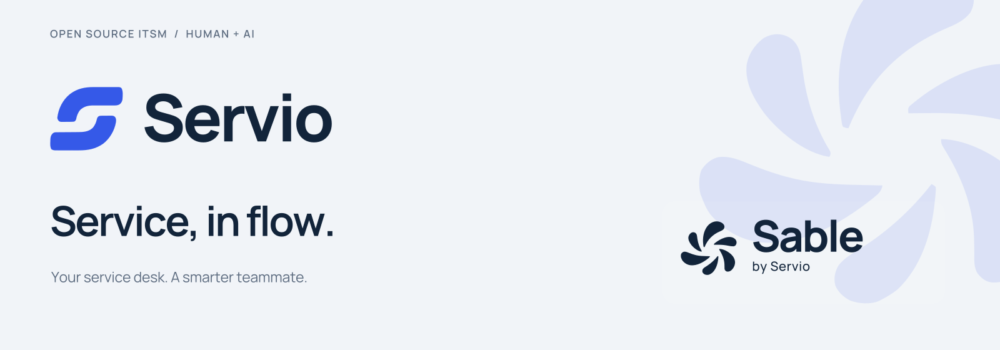
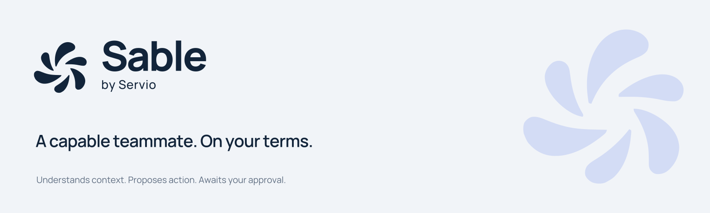
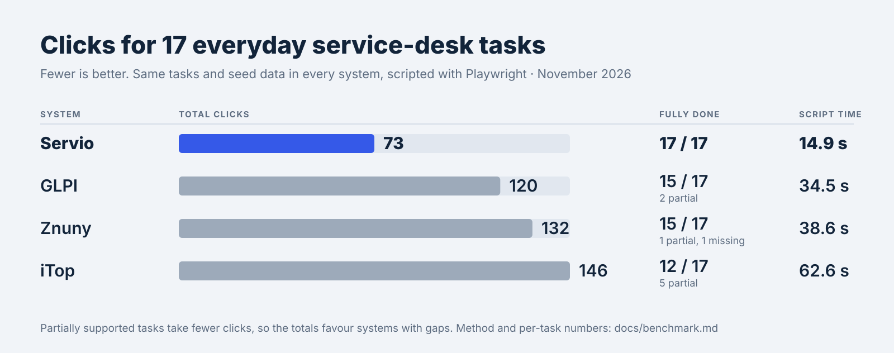
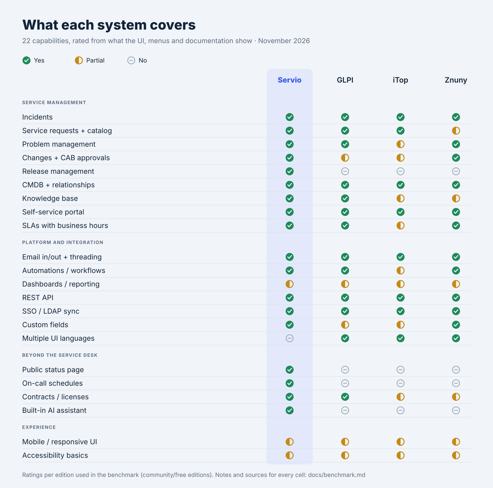

<div align="center">

<picture>
  <source media="(prefers-color-scheme: dark)" srcset="branding/exports/banners/readme-family-dark.svg">
  
</picture>

### The open-source ITSM platform with an AI teammate built in.

A modern service desk — tickets, problems, changes, CMDB, a self-service portal and a
clean REST API — with **Sable**, an AI agent that actually works your queue *with your approval*.

[](LICENSE)
[](https://nextjs.org)
[](https://react.dev)
[](https://www.prisma.io)
[](https://www.typescriptlang.org)
[](CONTRIBUTING.md)

</div>

https://github.com/user-attachments/assets/cc246129-572c-4b97-ae7f-34e2cd2addd6

<p align="center">
  <code>Tickets</code> · <code>Problems</code> · <code>Changes</code> · <code>CMDB</code> ·
  <code>Service Catalog</code> · <code>Self-Service Portal</code> · <code>Knowledge Base</code> ·
  <code>Mail Engine</code> · <code>Infra Syncs</code> · <code>SSO</code> · <code>REST API</code> ·
  <code>AI Agent</code>
</p>

---

## Quick start

Servio ships as prebuilt Docker images (`linux/amd64` + `linux/arm64`) — no clone, no Node
toolchain. On a Linux host with Docker Compose:

```bash
mkdir servio && cd servio
curl -fsSLO https://raw.githubusercontent.com/jonax1337/Servio-ITSM/main/docker-compose.release.yml
cat > .env <<EOF
AUTH_SECRET=$(openssl rand -base64 32)
SETTINGS_ENCRYPTION_KEY=$(openssl rand -base64 32)
DOCKER_GID=$(stat -c %g /var/run/docker.sock)
EOF
docker compose -f docker-compose.release.yml up -d   # → http://localhost:3000
```

That starts the app (SQLite + uploads on the `servio-data` volume), Gotenberg for office
previews, and the **updater** sidecar that lets admins install new releases from
**Settings › Updates**. The first boot migrates the database and seeds demo data.
Pin a version with `SERVIO_VERSION=0.3.1` in `.env` (default: `latest`). Behind a domain, also set
`APP_URL` and `AUTH_URL` to the public origin.

> **Demo login** — `admin@servio.dev` / `servio123`
> Every seeded account uses `servio123`. Try `mara@servio.dev` (Manager), `sam@servio.dev`
> (Agent), or `liam@servio.dev` (User → lands in the self-service portal).
> On a real deployment, change these passwords and revoke the seeded demo API token
> (**Settings › API Tokens**) right after the first login.

Setup, Postgres, scaling and the updater's security model → [docs/deployment.md](docs/deployment.md) ·
[docs/updates.md](docs/updates.md)

### From source (development)

```bash
pnpm install
cp .env.example .env          # then: npx auth secret  → set AUTH_SECRET
pnpm db:migrate               # create the SQLite schema
pnpm db:seed                  # rich demo data
pnpm dev                      # → http://localhost:3000
```

Requires Node 24 and pnpm 11. The only value you **must** set is `AUTH_SECRET`; SSO, SMTP,
storage and AI are all optional. Full walkthrough → [docs/development.md](docs/development.md)

---

## Meet Sable — your AI service-desk teammate

<picture>
  <source media="(prefers-color-scheme: dark)" srcset="branding/exports/banners/readme-sable-dark.svg">
  
</picture>

**Sable is Servio's headline feature: an AI teammate that lives inside the service desk and
does real work, not just chat.** One streaming chat window (powered by [assistant-ui](https://www.assistant-ui.com)),
reachable from a floating button anywhere in the console, with folders to organise conversations.

|  | What it does |
|---|---|
| 🧠 **Knows your data** | Lists *your* tickets and the team backlog, opens any ticket in full (SLA, breaches, comments), free-text searches tickets/problems/changes/KB — and can search the web when the answer isn't in-house. |
| ✅ **Acts, but only on approval** | Proposes changes as **approval cards** (*"Resolve INC-0042 as Fixed"*). You click **Approve** — only then does the mutation run, re-validated server-side. Nothing is written until you say so. |
| 🛡️ **Bounded by your RBAC** | Tickets, categories, groups, users, services, catalog, CMDB, KB, problems & changes — and, for admins, SLAs and settings. Sable can do exactly what *you* could in the UI, never more. |
| 🔒 **Self-hostable & private** | Runs fully local on **Ollama** (nothing leaves the box) or via your own **Anthropic / OpenAI** key. A hard privacy gate blocks external providers unless you opt in. |

**End users get Sable too.** The self-service portal has its own **Ask Sable** — a deliberately
smaller, USER-scoped assistant on the same UI. It answers from the *public* KB and catalog, reads
that user's *own* tickets, understands attached screenshots of an error, and opens a
correctly-routed ticket or catalog request — all confirm-first. It shares **none** of the agent tools.

Deep dive → [docs/ai.md](docs/ai.md)

Brand assets → [Servio + Sable brand kit](branding/README.md) · [Brand guidelines](branding/brand-guide.pdf)

---

## How Servio compares

<picture>
  <source media="(prefers-color-scheme: dark)" srcset="docs/benchmark/clicks-dark.svg">
  
</picture>

We scripted 17 everyday tasks, from an end user reporting an incident to an admin adding a
category, and ran them in Servio, GLPI, iTop and Znuny with the same seed data. Servio needs
**73 clicks** for all of them (GLPI 120, Znuny 132, iTop 146) and is the only one of the four
that completes every task without a workaround.

<picture>
  <source media="(prefers-color-scheme: dark)" srcset="docs/benchmark/features-dark.svg">
  
</picture>

Feature for feature, Servio covers the ITSM core the others do and adds release management,
a public status page, on-call schedules and a built-in AI assistant. Where it is behind: the UI
is English-only, and reporting is dashboards rather than a report builder.

Per-task numbers, notes and sources for every feature cell, versions, method and the limits of
the comparison → [docs/benchmark.md](docs/benchmark.md)

---

## Features

- **Service desk** — incidents & requests with priority, impact/urgency, **business-hours SLA targets
  with tiered escalation** (working-hours calendars, holidays, and staged notify/reassign/bump policies),
  admin-configurable **workflow governance** (status-transition rules), inline-editable properties (type
  is switchable, its reference number stays stable), cross-entity linking to problems/changes/assets, and
  a threaded activity log with internal notes.
- **Agent macros** — reusable canned responses / one-click bundles of ticket actions, personal or
  team-shared, applied from the ticket detail (transitions & RBAC re-validated on apply).
- **Cross-field search & CSV export** — free-text ticket search spanning title, description, comments,
  requester, and custom fields; export the ticket list (or, for admins, the audit log) to CSV.
- **CSAT surveys** — a public, one-time satisfaction rating minted on resolution and linked from the
  resolution email, with an average-score dashboard widget.
- **Automatic closing** — resolved tickets close on their own after a configurable number of days
  (off by default); a reply from the requester before then reopens them as usual.
- **Admin audit log** — an ADMIN-only viewer over every recorded action, with user/entity/action/date
  filters and CSV export.
- **Automations** — condition→action rules on ticket create/update and on SLA at-risk/breach
  (assign, set fields, escalate, notify, webhook, declare a major incident…).
- **Customizable dashboards** — a drag-and-drop, resizable widget grid: stats, bar/donut
  breakdowns, SLA gauges, trends and aging. Per-widget filters, accent colour and value
  **thresholds** (`< 15 → red`), each drilling into the matching ticket list. Personal + shared boards.
- **Saved views** — save any set of ticket filters as a named, searchable view (personal or team).
- **Recurring tickets** — ticket templates on a daily / weekly / monthly / yearly schedule (DST- and
  month-end-safe), created a set number of days before each due date through the normal pipeline,
  exactly once per occurrence, with pause, "create now" and a REST API for importing GLPI schedules.
- **Problem & change management** — root-cause / known-error tracking; normal/standard/emergency
  changes with a **Change Advisory Board (CAB)** approval flow (**unanimous, quorum, or percentage**
  approval rules), implementation & rollback plans, and affected CIs with automated impact/risk.
- **Release management** — bundle changes into releases (planning → ready → deployed), with a
  **change calendar**, **freeze windows** and reusable standard-change templates.
- **On-call, status page & contracts** — on-call schedules, a service status page
  (`/status` for agents, `/portal/status` for signed-in users), and contracts / software licenses with renewal reminders.
- **CMDB / Assets** — typed configuration items with a **dependency graph**, **blast-radius impact
  analysis**, **locations**, and linked tickets.
- **Service catalog** — requestable services with live status (operational / degraded / outage) and SLAs,
  plus **multi-stage / group approval** workflows and re-request after rejection.
- **Knowledge base** — published how-to / troubleshooting articles with internal vs. public visibility,
  surfaced in the console, the portal, and Sable's search.
- **Mail engine** — a real two-way email bridge: outbound SMTP notifications and **inbound IMAP**
  polling that turns replies into ticket comments, with RFC-2822 threading (message-id / references),
  HTML + CC. No SMTP configured? It runs in outbox mode. Every outgoing mail is an editable,
  translated template, and each agent chooses which notifications they also get by email.
- **Infrastructure Syncs** — pluggable connectors importing **users & assets** on a cron schedule
  or on demand, with run history: Active Directory / LDAP, Azure AD / Entra, CSV, and generic REST (e.g. NetBox).
- **Self-Service Portal** — a redesigned help center: one **live search** across KB, catalog and
  your tickets; report issues or request services with **screenshot/file attachments**; track and
  reply to tickets; and **Ask Sable**.
- **SSO** — OIDC (Keycloak, Authentik, Azure AD, Okta, Google…) plus email/password.
- **English & German UI** — console, portal, sign-in page and the built-in emails in each user's language (account setting, instance default `APP_LOCALE`); see [docs/i18n.md](docs/i18n.md).
- **RBAC** — Admin / Manager / Agent / User, enforced in `proxy.ts` and every server action.
- **Self-update & maintenance windows** — admins schedule an update to a newer release from
  **Settings › Updates**; users get a banner and a maintenance page, the updater sidecar backs up
  the database and rolls back automatically if the new version is unhealthy.
- **Public REST API** — versioned `/api/v1`, Bearer-token auth with scopes, pagination, filtering, and an OpenAPI 3.1 doc.
- **Relay + Nova Flow branding** — Navy/Cobalt themes, local Manrope display type,
  Servio/Sable vector marks, icons and share previews from the [brand kit](branding/README.md).
- **Beautiful by default** — a quiet service-desk layout, command palette (⌘K),
  responsive layout, and designed empty/loading states.

---

## Tech stack

| Layer | Choice |
|-------|--------|
| **Framework** | Next.js 16 · App Router · React 19 · Turbopack |
| **UI** | base-ui + Tailwind v4 · lucide icons · Recharts · assistant-ui (chat) |
| **Data** | Prisma 6 — SQLite (dev) / PostgreSQL (prod) |
| **Auth** | Auth.js v5 — Credentials + OIDC, JWT sessions |
| **AI** | Vercel AI SDK 7 — Anthropic / OpenAI-compatible / Ollama / Claude CLI |
| **Validation** | Zod 4 — shared by server actions *and* the REST API |

---

## Enabling Sable

Off by default. Configure it in **Settings › Sable (AI assistant)** (ADMIN) or in `.env` (next to the
compose file with Docker). The privacy-safe way to switch it on is **local Ollama** — no key, nothing leaves the box:

```dotenv
AI_PROVIDER="ollama"
OLLAMA_BASE_URL="http://localhost:11434/v1"
OLLAMA_MODEL="llama3.1"
```

With Docker, `localhost` is the container itself: point `OLLAMA_BASE_URL` at the Ollama host instead
(e.g. `http://host.docker.internal:11434/v1`, which on Linux needs `extra_hosts: ["host.docker.internal:host-gateway"]` on `web`).

Prefer a hosted model? Pick the provider, flip the privacy gate, add a key:

```dotenv
AI_PROVIDER="anthropic"       # or "openai"
AI_ALLOW_EXTERNAL="true"      # required for ANY external provider
ANTHROPIC_API_KEY="sk-ant-…"  # or OPENAI_API_KEY (+ optional OPENAI_BASE_URL)
```

| Provider | Runs | Key | Notes |
|----------|------|-----|-------|
| **Ollama** | Local, on-box | — | Fully offline. The privacy-safe default. |
| **Anthropic** | External API | `ANTHROPIC_API_KEY` | Default `claude-sonnet-5`. Needs the external gate. |
| **OpenAI-compatible** | External API | `OPENAI_API_KEY` | OpenAI, OpenRouter, Moonshot/Kimi, Zhipu/GLM… |
| **Claude subscription** | Claude Code CLI | `CLAUDE_CODE_OAUTH_TOKEN` | Uses a Claude Pro/Max subscription — connect it in Settings. |

Every provider runs through the **Claude Code** CLI, which ships inside the Claude Agent SDK
dependency (nothing extra to install, also in the Docker image), so all models share one agent loop
and the chat shows thinking and tool calls live; OpenAI-compatible and Ollama models are translated
by a built-in localhost proxy.

Point Sable at a **vision-capable** model to read attached screenshots. Everything is also
manageable from **Settings › Sable (AI assistant)** (ADMIN), which overrides `.env` and encrypts
keys at rest. Full reference → [docs/ai.md](docs/ai.md)

---

## REST API

Authenticate with a Bearer token (create one under **Settings › API Tokens**):

```bash
curl "http://localhost:3000/api/v1/tickets?status=open" \
  -H "Authorization: Bearer <token>"
```

```
GET/POST   /api/v1/tickets          GET/PATCH  /api/v1/tickets/{id}
GET/POST   /api/v1/assets           GET/PATCH  /api/v1/assets/{id}
GET        /api/v1/services         GET        /api/v1/openapi   (OpenAPI 3.1)
GET/POST   /api/v1/changes          GET/PATCH  /api/v1/changes/{id}    POST /changes/{id}/transitions
GET/POST   /api/v1/problems         GET/PATCH  /api/v1/problems/{id}   POST /problems/{id}/transitions
GET/POST   /api/v1/{tickets|changes|problems}/{id}/comments
POST       /api/v1/changes/{id}/approvals/{approval_id}
GET        /api/v1/categories       GET        /api/v1/groups          GET  /api/v1/users
```

Changes, problems and links run the console's own actions as the token owner, so the
workflow map, CAB, freeze windows and audit trail apply to the API exactly as in the UI.

Seeded dev token (`read,write`, owned by `admin@servio.dev`): `servio_demo_pat_0123456789abcdef`.
Full reference → [docs/rest-api.md](docs/rest-api.md)

---

## Architecture

```
app/
  (console)/   Agent console — dashboard, Sable, every module (route group, mounted at /)
  portal/      Self-service portal for end users
  login/       Auth pages
  api/v1/      Public REST API (token auth)
components/     Shared UI + base-ui primitives (components/ui)
lib/            db, session, constants (enums), actions, ai-operations (RBAC-gated writes)
prisma/         schema.prisma + seed
proxy.ts        Middleware / edge auth gate (Next 16 naming)
```

- **Server Actions** (`lib/actions/*`) power the app's mutations; **Route Handlers** (`app/api/*`) serve the outside world.
- **All AI runs server-side** — provider keys never reach the client; every Sable write goes
  through the same RBAC-checked path as the UI (`lib/ai-operations/*`).
- **Enum fields are `String` columns** backed by typed constants in `lib/constants.ts` — flip the
  datasource to PostgreSQL with no schema changes.

Deep dive → [docs/architecture.md](docs/architecture.md)

---

## Documentation

| Doc | Contents |
|-----|----------|
| [development.md](docs/development.md) | Local setup, demo credentials, conventions |
| [configuration.md](docs/configuration.md) | Environment variables, SSO, SMTP, AI, storage |
| [ai.md](docs/ai.md) | **Sable** — providers, privacy gate, tools & the approve-first flow |
| [architecture.md](docs/architecture.md) | Runtime model, RBAC, sync engine |
| [data-model.md](docs/data-model.md) | Prisma schema & enum strategy |
| [rest-api.md](docs/rest-api.md) | The `/api/v1` REST API |
| [design-system.md](docs/design-system.md) | Theme, tokens, and UI primitives |
| [branding.md](docs/branding.md) | Brand kit, shared logos, fonts and generated application assets |
| [modules.md](docs/modules.md) | Feature-to-file map |
| [deployment.md](docs/deployment.md) | Docker, PostgreSQL, production, persistence |
| [updates.md](docs/updates.md) | Self-update, maintenance windows, the updater sidecar |
| [releasing.md](docs/releasing.md) | CI checks, cutting a release, published images |
| [benchmark.md](docs/benchmark.md) | The usability benchmark against GLPI, iTop and Znuny |

---

## Scripts

| Script | Description |
|--------|-------------|
| `pnpm dev` | Dev server (Turbopack) |
| `pnpm build` / `pnpm start` | Production build & serve |
| `pnpm lint` | Lint (`eslint` / `eslint-config-next`) |
| `pnpm typecheck` | Route types + `tsc --noEmit` |
| `pnpm test` / `pnpm test:e2e` | Vitest unit tests / Playwright link crawl |
| `pnpm brand:check` / `pnpm brand:sync` | Validate / synchronize application assets from the canonical brand kit |
| `pnpm db:migrate` | Prisma migrations (`prisma migrate dev`) |
| `pnpm db:seed` | Seed demo data |
| `pnpm db:reset` | Reset DB + reseed |
| `pnpm db:studio` | Open Prisma Studio |
| `pnpm setup` | `prisma migrate deploy && prisma db seed` (CI / first deploy) |

---

## Going to production

The [Docker quick start](#quick-start) is the supported production setup: put it behind a
TLS reverse proxy, set `APP_URL`/`AUTH_URL` to the public origin, and keep the `servio-data`
volume backed up. The published image targets SQLite; PostgreSQL means switching the
datasource in `prisma/schema.prisma` and building your own image. Run a single app instance
(the background scheduler is not multi-instance safe). See [docs/deployment.md](docs/deployment.md).

---

<div align="center">

**Contributions welcome** — start with [CONTRIBUTING.md](CONTRIBUTING.md).

Built with Next.js, Prisma & Sable · MIT licensed — see [LICENSE](LICENSE)

</div>
