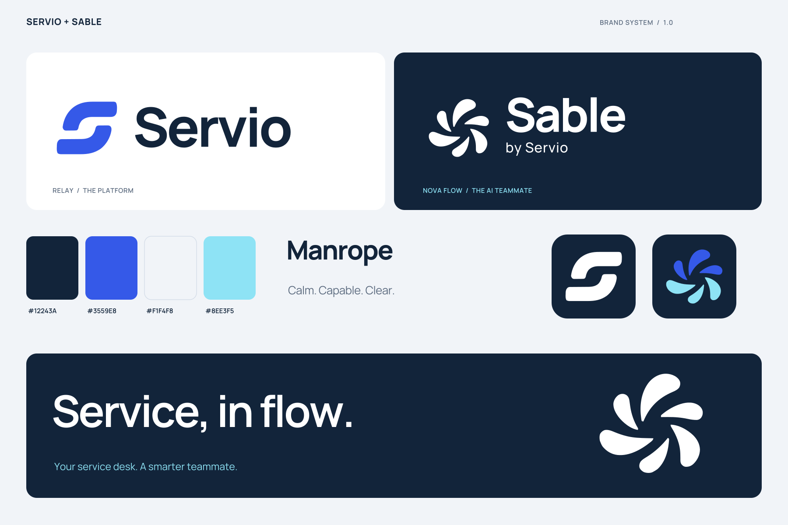

# Servio + Sable Brand Kit

The finished identity combines **Servio Relay** with **Sable Nova Flow**. Sable's approved symbol is the first Nova Flow direction with six separated, curved segments. Nova Flow names the visual direction; the assistant remains Sable.

Open [index.html](index.html) for a visual gallery with downloads, or use the [eight-page PDF guide](brand-guide.pdf). The complete handoff is packaged as `servio-sable-brand-kit.zip` after a build.



## File reference

| Need | Location |
| --- | --- |
| Servio logos and wordmarks | [exports/servio/svg](exports/servio/svg/) |
| Sable logos, wordmarks and “by Servio” lockups | [exports/sable/svg](exports/sable/svg/) |
| Transparent PNG logos | `exports/servio/png/`, `exports/sable/png/` |
| App icons, favicons, Touch/PWA icons, ICO and ICNS | `exports/servio/icons/`, `exports/sable/icons/` |
| Joint, Servio and Sable README banners | [exports/banners](exports/banners/) |
| Social previews, 1200 × 630 and 2400 × 1260 | [exports/social](exports/social/) |
| Full HD and 4K desktop backgrounds | [exports/wallpapers](exports/wallpapers/) |
| Transparent repeat patterns | [exports/patterns](exports/patterns/) |
| Color tokens | [CSS](exports/tokens.css), [JSON](exports/tokens.json) |
| Designer color swatches | [Adobe ASE](exports/palette.ase), [GIMP GPL](exports/palette.gpl) |
| Brand guide | [PDF](brand-guide.pdf), [HTML](brand-guide.html) |
| Full asset inventory, dimensions and hashes | [asset-manifest.json](asset-manifest.json) |
| Font files and their license | [fonts](fonts/README.md) |
| Canonical geometry and brand settings | `source/marks.json`, `source/brand.json` |

## Choose the right logo

- `primary`: cobalt Servio symbol with navy wordmark; navy Sable symbol and wordmark. Use on light backgrounds.
- `inverse`: white artwork for dark backgrounds.
- `black` and `white`: pure monochrome artwork for single-color output.
- `horizontal`: standard symbol-and-wordmark lockup.
- `stacked`: compact vertical lockup.
- `wordmark`: lettering without a symbol.
- `symbol`: the standalone emblem.
- `endorsed`: Sable with the “by Servio” line, recommended outside Servio and when introducing the assistant.

All logos are genuine vectors, including outlined wordmarks. Transparent symbol PNGs are supplied at 128, 256, 512, 1024 and 2048 px. Horizontal and wordmark PNGs are supplied at 1200 and 2400 px width; stacked logos at 800 and 1600 px width.

Keep a clear area of at least one quarter of the visible symbol height around a complete mark or lockup. The files contain base padding; add the remaining clear space in the destination layout. Identity symbols start at 24 px; labelled inline functions can use 14 px, and favicons use 16 px. Minimum horizontal logo width is 140 px. Print starting points are 8 mm for a symbol and 35 mm for a horizontal logo.

## Banners and social media

The family README banner is 1600 × 560 px. Individual brand banners are 1600 × 480 px. Every banner has light and dark SVGs plus PNGs at normal and double resolution. Social previews are 1200 × 630 px, also supplied at double resolution.

The repository README already uses the family and Sable banners through theme-aware `<picture>` elements. Its light fallback works in viewers without picture support.

For GitHub's repository social preview, upload `exports/social/servio-github-dark.png` (1280 × 640 px) in the repository settings. Both brands also have light and double-resolution GitHub exports. The kit provides the files; it does not change repository settings.

## Web and desktop icons

Each brand includes square light, dark and accent app icons from 16 to 1024 px. Let the target platform apply its own corner mask. Maskable PWA icons use a smaller emblem inside the central safe circle.

Use `apple-touch-icon.png` for Apple touch bookmarks, `favicon.ico` or `favicon.svg` for a browser, `icon-192.png` and `icon-512.png` for PWA applications, and the supplied `.ico` / `.icns` files for desktop packaging. `site.webmanifest` is a starting template: adjust application paths and names when integrating it.

The Web App uses this identity in the login, console, portal, Sable UI, navigation and metadata. Manrope is locally hosted for headings; Inter remains the dense UI font. Runtime copies and outlined geometry are generated by `scripts/sync-brand-assets.mjs`. The application build checks them before Next.js runs. See `docs/branding.md` in the Servio repository for the integration reference.

After changing the kit, run `pnpm brand:sync` from the repository root. `pnpm brand:check` validates the application copies without writing them. The full kit build below remains a separate authoring toolchain.

## Color and typography

| Role | Hex | RGB |
| --- | --- | --- |
| Navy | `#12243A` | 18 / 36 / 58 |
| Cobalt | `#3559E8` | 53 / 89 / 232 |
| Mist | `#F1F4F8` | 241 / 244 / 248 |
| Ice | `#8EE3F5` | 142 / 227 / 245 |

Assets use sRGB. Use navy text on light backgrounds, white on navy or cobalt, and dark text on ice. Keep business status colors separate from brand accents. The SVGs are RGB masters; use the printer's target profile when preparing print output.

Manrope is the brand typeface. Wordmarks use weight 750, display typography 650, and body copy 400. The complete variable font and static instances are included. Inter and JetBrains Mono remain UI/code recommendations from the existing product and are not bundled here.

## Rebuild

From the repository root:

```powershell
python -m pip install -r branding/requirements.txt
npm ci --prefix branding
npm --prefix branding run build
```

The build requires Python, Node.js and a browser for the PDF. Windows uses installed Microsoft Edge in headless mode. On other systems, install Playwright Chromium from the `branding` directory with `npx playwright install chromium`.

`tools/build.py` reads the canonical geometry and generates outlined SVGs, static fonts and a PNG export plan. `tools/render.mjs` renders PNGs directly from the SVGs, checks dimensions, prints the guide and verifies the gallery at desktop and mobile widths. `tools/package.py` creates native icons and swatches, checks transparency and SVG structure, records hashes, and builds the ZIP.

The two approved raster references remain in `source/references/` as provenance. Geometry is reconstructed in `source/marks.json`; ordinary rebuilds do not trace images again. To deliberately reconstruct the geometry from those original references, run `python branding/tools/trace.py` before rebuilding.

## License and attribution

The bundled Manrope font is from the [Google Fonts Manrope project](https://github.com/google/fonts/tree/main/ofl/manrope), licensed under the [included SIL Open Font License 1.1](fonts/OFL-Manrope.txt). The exported logos and banners use outlined text. A copy of the repository's project license is included as [LICENSE-PROJECT.txt](LICENSE-PROJECT.txt); the font retains its separate license.
