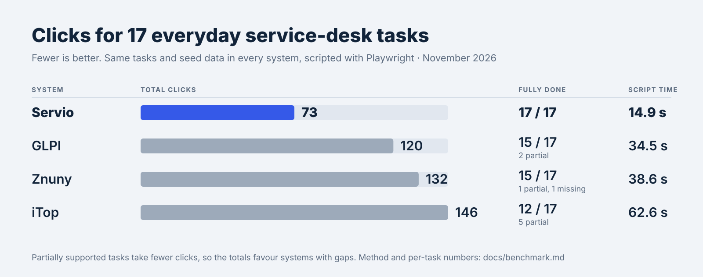

# ITSM usability benchmark

How many clicks, typed fields and page loads does an experienced user need for everyday
service-desk work? We measured the same 17 tasks in Servio and three established open-source
ITSM systems. The README chart is generated from the data in
[`benchmark/results.json`](./benchmark/results.json).

<picture>
  <source media="(prefers-color-scheme: dark)" srcset="benchmark/clicks-dark.svg">
  
</picture>

Measured on 2026-11-06.

| System | Version |
| --- | --- |
| Servio | `main` after the UX benchmark fixes, local production build |
| GLPI | `glpi/glpi:latest` Docker image, using its form-based service catalog |
| iTop | 3.3.0, `vbkunin/itop` community image, ITIL setup with sample data |
| Znuny | 7.3.8 with the ITSM bundle 7.3.2, official Docker images |

## Totals

|  | Servio | GLPI | iTop | Znuny | Servio before |
| --- | --- | --- | --- | --- | --- |
| Clicks | 73 | 120 | 146 | 132 | 94 |
| Typed fields | 17 | 19 | 53 | 39 | 21 |
| Page loads | 23 | 50 | 74 | 63 | 29 |
| Script time (sum of medians) | 14.9 s | 34.5 s | 62.6 s | 38.6 s | 16.7 s |
| Tasks fully done | 17 / 17 | 15 / 17 | 12 / 17 | 15 / 17 | 15 / 17 |

"Servio before" is the same benchmark run before the fixes it led to (immediate-save ticket
properties with Undo, problem and KB article from a ticket, multi-field bulk edit, the SLA
column, affected CIs in the change form, group picker on new people).

## Per task

Cells are `clicks · typed fields`. Bold marks the fewest clicks among the systems that
fully completed the task.

| Task | Role | Servio | GLPI | iTop | Znuny |
| --- | --- | --- | --- | --- | --- |
| **T1** Submit an incident in self-service with category and attachment | End user | **5 · 2** | **5 · 2** | **5 · 3** | 7 · 2 |
| **T2** Find my open request and reply | End user | **2 · 1** | 3 · 1 | 3 · 1 | **2 · 1** |
| **T3** Search the KB for "VPN" and open the article | End user | **1 · 1** | **1 · 1** | 2 · 1 | 3 · 1 |
| **T4** Order the "New laptop" catalog item with one custom field | End user | 4 · 1 | **3 · 1** | 3 · 3 (partial) | not supported |
| **T5** Find the new incident, assign it to myself, set priority High | Agent | **6 · 0** | 9 · 0 | 12 · 0 | 10 · 5 |
| **T6** Reply to the requester and add an internal note | Agent | **4 · 2** | 6 · 2 | 7 · 2 | 5 · 3 |
| **T7** Link the incident to a CI and to a related incident | Agent | **6 · 0** | 12 · 0 | 10 · 2 | 11 · 2 |
| **T8** Resolve with a resolution note (and close if separate) | Agent | 3 · 1 | 7 · 1 | 9 · 1 | **2 · 2** |
| **T9** Create a problem from two related incidents | Agent | **6 · 0** | 9 · 0 | 14 · 5 | 12 · 4 |
| **T10** Find an asset by serial number via global search | Agent | **2 · 1** | **2 · 1** | 3 · 1 | 8 · 1 |
| **T11** Bulk-set 5 tickets to In progress / assign a group | Agent | 9 · 0 | 15 · 0 | 11 · 1 (partial) | **8 · 1** |
| **T12** Create a normal change with window, risk and CI, submit for approval | Manager | **9 · 5** | 18 · 4 (partial) | 29 · 16 (partial) | 29 · 8 |
| **T13** Approve the change | Manager | **2 · 0** | 3 · 0 | 7 · 3 | 8 · 0 |
| **T14** Create a KB article from a resolved ticket | Agent | **3 · 0** | 6 · 1 | 5 · 4 (partial) | 5 · 4 (partial) |
| **T15** See SLA breaches and at-risk tickets | Manager | 1 · 0 | 4 · 0 (partial) | 2 · 0 (partial) | **0 · 0** |
| **T16** Add an agent and put them in a group | Admin | **7 · 2** | 11 · 4 | 16 · 8 | 9 · 4 |
| **T17** Add a ticket category/service selectable in the portal | Admin | **3 · 1** | 6 · 1 | 8 · 2 | 13 · 1 |

## Method

Every system got the same seed data before measuring: three users (end user, agent, manager),
two groups, five services or categories, ten assets with one known serial number, twenty
tickets including two related printer incidents, three KB articles and a "New laptop" catalog
item with one custom field. Existing demo data was used where a system ships it.

Each task is a Playwright script that takes the shortest path an experienced user would take
through visible UI: menus, buttons, global search and advertised shortcuts, with no URL jumps
except the task's start page. Login is not counted. The script counts:

| Metric | Definition |
| --- | --- |
| Clicks | Pointer activations: links, buttons, selects, checkboxes, tabs. Opening a dropdown and picking an option counts as 2. |
| Typed fields | Fields that need keyboard input, each counted once regardless of length. |
| Page loads | Full navigations or route changes until the task is visibly done. |
| Script time | Wall-clock time of the script in Chromium at 1440 × 900 with a warm cache; median of 3 runs. |

A task is **partial** when the system can only do it with a workaround, and **not supported**
when it has no way to do it. Click counts were identical across the three runs of every task.

## Limits of the comparison

- Partial tasks usually take fewer clicks because part of the work is missing, so the totals
  favour systems with gaps. Znuny's T4 counts 0 clicks because it has no service catalog.
- Servio ran as a local production build and the other systems in Docker on the same machine.
  Script time therefore includes each environment's response time; clicks and fields do not.
- Znuny needs the SysConfig option `ITSMChange::Frontend::AgentITSMChangeEdit###ChangeState`
  enabled for T12 and T13; it was enabled before measuring.
- In the iTop community image the bulk "Assign" transition fails with a PHP error, so iTop's
  T11 measures a bulk change of urgency instead.
- GLPI changes have no planned window or risk field; T12 uses the opening and time-to-resolve
  dates instead.
- GLPI, iTop and Znuny cannot create a KB article from a ticket (T14); the text is retyped.
- Znuny shows escalated tickets on the agent dashboard, so T15 takes no click there; in Servio
  it is one click on the dashboard tile.
- The benchmark was designed and run by the Servio project. The scripts favour no system on
  purpose, but treat the results as a well-documented self-assessment, not an independent test.

## Updating the chart

Edit [`benchmark/results.json`](./benchmark/results.json) with the new measurements, then run:

```bash
pnpm benchmark:chart   # rewrites docs/benchmark/clicks-light.svg and clicks-dark.svg
```

Update the tables on this page and the numbers in the README's comparison section to match.
